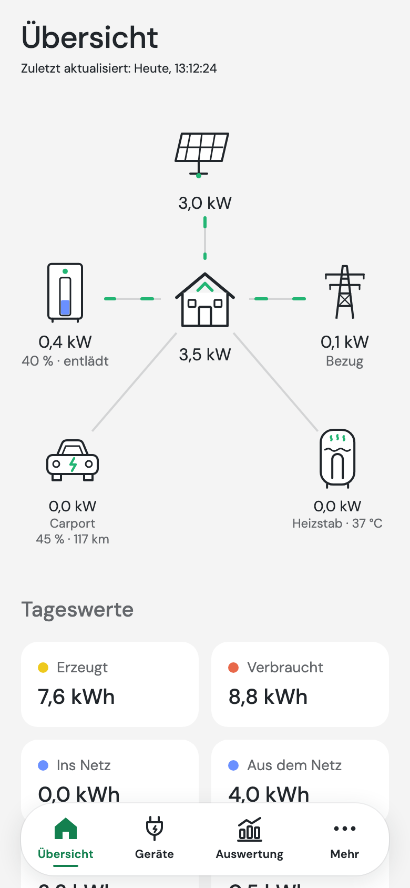
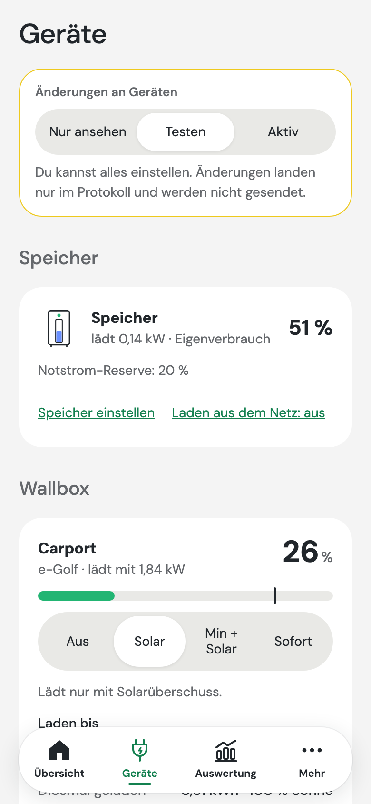
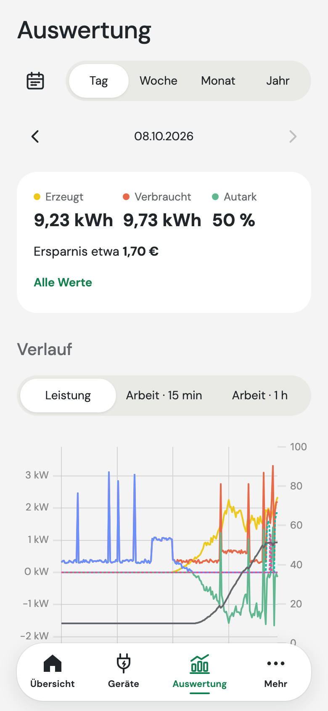
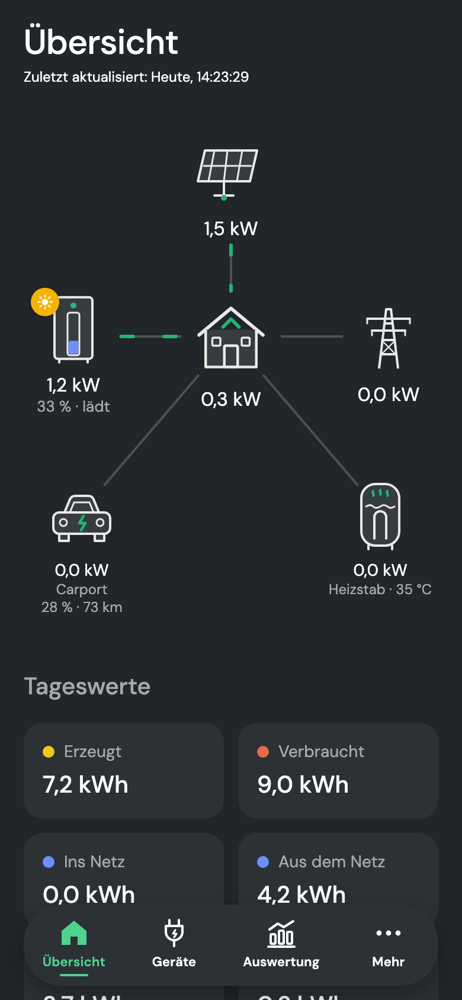

# OpenAmpere

**Deutsch:** [README.de.md](README.de.md)

[](https://scorecard.dev/viewer/?uri=github.com/Gr33ndev/OpenAmpere) [](https://www.bestpractices.dev/projects/15361)

[Website & Demo](https://gr33ndev.github.io/OpenAmpere/) · [FAQ](https://gr33ndev.github.io/OpenAmpere/faq.html) · [Source code](https://github.com/Gr33ndev/OpenAmpere) · [Questions](https://github.com/Gr33ndev/OpenAmpere/discussions) · [Roadmap](https://github.com/users/Gr33ndev/projects/1) · [Report a bug](https://github.com/Gr33ndev/OpenAmpere/issues) · [License](LICENSE) · [Third-party licenses](THIRD_PARTY_LICENSES.md) · [Security](SECURITY.md) · [Contributing](CONTRIBUTING.md) · [Code of Conduct](CODE_OF_CONDUCT.md) · [Governance](GOVERNANCE.md)

**Local app for solar systems with battery storage, no cloud at all.**

OpenAmpere talks to the inverter directly on your home network, stores all data locally and shows it in the browser. On a smartphone you can add the page to the home screen, and it then behaves like an app. No account, no cloud, no dependence on a manufacturer's server.

The app's user interface and the website are in German.

<p align="center">
  
  
  
  
</p>
<p align="center"><sub>From the <a href="https://gr33ndev.github.io/OpenAmpere/demo/">demo</a> with made-up values. Regenerate with <code>scripts/screenshots.sh</code>.</sub></p>

> Independent community project. Background and legal notes are [at the end of this page](#background--legal-notes).

## Supported devices

<!-- generated:devices from docs/devices/support.json by scripts/device-support.mjs; edit it there -->

| Device | What OpenAmpere does | Confirmed on a real system? |
|---|---|---|
| [FoxESS H3, newer firmware](docs/devices/foxess/h3.md) | Monitoring and control. Control is off by default. The new or old register map is detected automatically. | ✅ Monitoring and control confirmed |
| [FoxESS H3, older firmware / H3 Smart / H3 Pro](docs/devices/foxess/h3.md) | Monitoring and control; with older firmware without the feed-in limit | Not yet confirmed |
| [SAJ H2 / HS2](docs/devices/saj/h2-family.md) | Monitoring and control. Grid charging through a short charge time slot in the inverter, because SAJ has no remote control that ends by itself. | ✅ Monitoring confirmed and in daily use on a "3P-X E2" (older "Ampere.StoragePro"); control not yet confirmed |
| [Solarmax MAX.STORAGE ("AMPERE.Storage")](docs/devices/solarmax/max-storage.md) | Monitoring only: PV, battery, house, grid and state of charge. The energy history needs "Connectivity+", which only Solarmax unlocked. OpenAmpere changes nothing there. | Not yet confirmed |
| [M-TEC Energy-Butler GEN3](docs/devices/mtec/energy-butler.md) | Monitoring only: PV, battery, house, grid, state of charge and energy history. Through the Wi-Fi/LAN module, port 502 (5743 on older firmware). | Not yet confirmed |
| [Senec.Home V3 / V2.1](docs/devices/senec/home-v3.md) | Monitoring only through its web interface in the home network (no Modbus): PV, battery, house, grid and state of charge. Choose it as the device type under "Advanced" in the setup. There is no energy history, because the device no longer reports counters. | Not yet confirmed |
| [Enphase IQ Gateway with IQ Battery](docs/devices/enphase/iq-gateway.md) | Monitoring only through the gateway's local interface (no Modbus): PV, battery and state of charge, grid and house with consumption CTs. Needs an access token from the Enphase account once a year; enter it under "Advanced" in the setup. | Not yet confirmed |
| [Immersion heater, heat pump (SG-Ready)](docs/devices/topics/consumers.md) | Switching on solar surplus via Shelly relays or web addresses. | Not yet confirmed |
| [Immersion heater my-PV AC ELWA-E, AC ELWA 2, AC THOR](docs/devices/mypv/elwa.md) | Continuously variable according to solar surplus, optionally with cheap grid power. | Not yet confirmed |
| [FoxESS AC EV Charger ("Ampere.ChargePro")](docs/devices/foxess/ac-charger.md) | Monitoring directly over Modbus TCP. OpenAmpere controls charging as a test, and for real only after you switch it on for the wallbox in the app. | ✅ Monitoring confirmed on a charger of an EKD system; control not yet confirmed |
| [Weidmüller AC SMART ("AMPERE.Charge")](docs/devices/weidmueller/ac-smart.md) | Monitoring only over Modbus TCP: state, charging power, current and voltage per phase, energy of the charge. evcc can still control it (with a sponsor token). | Not yet confirmed |
| [Portable dé wallbox (Tuya Wi-Fi)](docs/devices/tuya/de-portable.md) | Monitoring and control (solar surplus, fast, off) over the local Tuya protocol; needs the device's local key once. | ✅ Monitoring confirmed; control not yet confirmed |
| [Wallbox through evcc](docs/devices/topics/wallboxes.md) | Via [evcc](https://evcc.io): monitoring and operation in OpenAmpere, see [docs/evcc.md](docs/evcc.md). For many wallboxes evcc requires a paid sponsor token ([list](https://docs.evcc.io/en/chargers)). | Not yet confirmed |
| [Cars of the Volkswagen group (Volkswagen, Audi, Škoda, SEAT, CUPRA)](docs/devices/cars/vw-eu-data-act.md) | Monitoring only, through the group's EU Data Act portal with the brand account (cloud, optional): state of charge, range and odometer, at least 15 minutes old. | Not yet confirmed |
| Home Assistant | Dedicated integration: live data and control. Comes with the Home Assistant app, otherwise via HACS, see [Installation](#installation). | – |

<!-- /generated:devices -->

**Not yet confirmed** means: the support is based on documentation from the manufacturers or the community and is checked with tests and the simulator, but nobody has reported it from a real system yet. It may well work. If you have such a device, help with a **device report**: in the app, start the diagnostics under **Mehr → Diagnose** (More → Diagnostics; it only reads and changes nothing), tap **Bericht kopieren** (Copy report) and paste the report into the [device report form](https://github.com/Gr33ndev/OpenAmpere/issues/new?template=device_report.yml). Remove IP addresses, passwords and API keys first. Every report helps to move a row to "confirmed".

**The device type is detected automatically.** Setup tries all known devices one after another, read-only: FoxESS at device address 247, SAJ at 1 and 2, Solarmax at 1, M-TEC at 252, 255 and 247. A Senec or an Enphase gateway has no Modbus: choose it as the device type under the advanced settings (Enphase also needs an access token from your Enphase account). So you don't need to know the device address or the manufacturer. The connection uses Modbus TCP, default port 502. New drivers are welcome, see `src/openampere/drivers/registry.py`.

Full list: [docs/devices.md](docs/devices.md), with what is read and controlled per model and what exactly has been confirmed on real hardware.

## Features

- **Menu:** **Übersicht** (Overview), **Geräte** (Devices: operate the battery, wallbox and immersion heater, and set the order in which they get solar power), **Auswertung** (Report) and **Mehr** (More: setup and settings). A switch **„Nur ansehen / Testen / Aktiv“** (View only / Test / Active) determines whether OpenAmpere is allowed to change anything.
- **Overview:**
  - Live energy flow for PV, house, grid and battery with state of charge, plus wallbox and immersion heater
  - Daily totals
  - Self-sufficiency
  - **Solar by module array:** power, voltage and current per PV input (MPPT), e.g. for the south roof, west roof or garage
  - **Temperatures:** inverter, battery, battery cells
- **Report:**
  - Power curve over the day with state of charge, values on tap
  - Energy per day (15 or 60 minutes), week, month and year
  - Yield per module array
  - Temperature history
  - Consumption per device (wallbox, immersion heater) and charging sessions
  - Self-sufficiency, self-consumption, consumption split between household and devices, estimated savings
- **Electricity tariffs:** fixed price or dynamic tariff (exchange price plus markup, Germany and Austria) with standing charge, multiple tariffs with start dates; from these, savings and the net electricity cost.
- **Keep track of advance payments:** enter monthly advance payments for grid consumption and feed-in (**Mehr → Abschläge** (More → Advance payments)). The report shows where you stand today: costs and feed-in compensation so far against the advance payments up to today, with the current month pro rata.
- **Meter readings from the grid operator:** with a smart meter, OpenAmpere fetches the daily values from the grid operator's customer portal (**Mehr → Verbindung → Zählerwerte** (More → Connection → Meter readings)) and uses them to calculate the advance payments. Currently for Netze BW; other grid operators can be added as separate modules.
- **Export:** energy values as a CSV file for Excel and similar tools.
- **Battery & backup power:** backup power reserve, charge limits, operating mode
- **Feed-in limit:** view and change the maximum feed-in power. You enter the installed module power (kWp) and the applicable rule: 60 % under the Solarspitzengesetz (German solar peak law; until a smart metering system with a control box is installed), the former 70 % rule, a fixed value from the grid connection approval (e.g. zero feed-in) or no limit. The percentages refer to the module power, not the inverter; the app does not allow more than the rule permits. **With a fixed value from the grid operator, any increase is only permitted with the grid operator's written consent**; the app requires a confirmation for this and logs the date and reference. "No limit" requires an explicit declaration, which is also logged.
- **Import history from the EKD cloud:** for previous users of the "Ampere.IQ" app. Under **Mehr → Daten & Sicherung** (More → Data & backup), enter the API key from the Ampere.IQ app and start the import. The import only uses the public customer API with your own key; OpenAmpere has nothing to do with EKD, see [legal notes](#background--legal-notes).
  - It runs in the background with at most one request per minute.
  - After a restart, it continues where it left off.
  - Alternatively, a ZIP from the [export tool](tools/cloud-export/) can be imported.
- **Cloud-compatible interface:** `/api/v1/customer/installation` and `/api/v1/installation/{id}/now/all/power` respond like the previous cloud customer API. Existing tools only need to be pointed at the new address.
- **Charging from the grid (experimental):** at the cheapest exchange price or in a fixed time window, up to a charge target. Only works via the inverter's remote control with a time limit; in test mode it is only logged. Legal notes must be confirmed first (EEG storage, § 14a EnWG).
- **Use surplus:** a my-PV immersion heater (AC ELWA-E, AC ELWA 2, AC THOR) follows the solar surplus continuously, with minimum surplus, maximum power, battery priority and optionally cheap grid power. OpenAmpere switches a heat pump (SG-Ready) or other devices via Shelly relays or web addresses, by priority, with minimum run time and minimum pause time.
- **Battery health** (**Mehr → Meine Anlage** (More → My system)): full cycles, efficiency since commissioning, temperature of the warmest and coolest cell and their difference, with a warning for unusual values.
- **Firmware changes:** OpenAmpere remembers the inverter's firmware and shows when it has changed. An update can change registers; afterwards it's best to run the diagnostics once.
- **Notifications** via ntfy: inverter unreachable, fault, overwritten setting, battery full, cheapest power tomorrow, check battery, new firmware, start and end of charging at the wallbox.
- **Diagnostics (read-only):** checks the register map, function codes, optional blocks, scaling, feed-in limit, connection drops and daily counters of your own device, and creates a report to share. **Run it once before the first change to the inverter.** Under **Gerät auslesen** (Read a device) it also reads registers of any Modbus device in your home network, for example a wallbox OpenAmpere does not know yet, so support for it can be added.
- **Wallbox with evcc:** most wallboxes are controlled by the independent open-source project [evcc](https://evcc.io). OpenAmpere supplies evcc with the grid, solar and battery readings, so evcc doesn't need its own connection to the inverter, and shows the charge points in the app: charging mode, charge target, minimum charge, charging plan, time until target and charging sessions. If the car itself is set up in evcc, state of charge and range are added, and the report shows kilometres driven, kilometres on solar power, consumption per 100 km and cost per 100 km compared with grid power. Whether the wallbox or the immersion heater gets surplus first is configurable. For many wallboxes evcc requires a sponsor token, which costs money; the [evcc wallbox list](https://docs.evcc.io/en/chargers) shows which ones work without ([details](docs/evcc.md#costs-the-evcc-sponsor-token)). Setup: [docs/evcc.md](docs/evcc.md). Thanks to the evcc community!
- **Wallbox without evcc:** the portable 11 kW wallbox sold as "dé" (Tuya Wi-Fi) OpenAmpere reads and controls itself, without evcc and without a cloud: charging mode (manual, off, solar, minimum + solar, fast), current per phase, several wallboxes. It is often unplugged; OpenAmpere then shows it as not reachable and reconnects by itself. Needs the wallbox's local key from Tuya's developer platform. Setup: [docs/wallbox-direct.md](docs/wallbox-direct.md).
- **State of charge of the car (Volkswagen group):** for cars from Volkswagen, Audi, Škoda, SEAT and CUPRA, OpenAmpere can read state of charge, range and odometer from the group's EU Data Act portal with the owner's brand account (optional and read-only; the values are at least 15 minutes old). At a wallbox OpenAmpere controls itself, every charge is stored with the state of charge at plug-in and the kilometres driven, for consumption per 100 km. Setup: [docs/car.md](docs/car.md).
- See also [docs/architecture.md](docs/architecture.md).

## Installation

OpenAmpere runs in one of two ways. Choose one of them: only one OpenAmpere may talk to the inverter.

1. **[Standalone](#way-1-standalone)** on a Linux computer with Docker, e.g. a Raspberry Pi, NAS or Proxmox server.
   If you use Home Assistant, you can connect it with the OpenAmpere integration (HACS) when you like.
2. **[As a Home Assistant app](#way-2-home-assistant-app)**, if you run Home Assistant OS (e.g. on a Home Assistant
   Green or a Raspberry Pi). OpenAmpere then runs inside Home Assistant and opens in its sidebar.

| | Way 1: standalone | Way 2: Home Assistant app |
|---|---|---|
| Runs on | its own Linux computer with Docker | Home Assistant OS |
| Opens | in the browser, also as an app on the phone | in the sidebar of Home Assistant, and in the browser by IP address |
| Home Assistant | optional: install the integration via HACS | the app brings the integration along: no HACS |
| Updates | in OpenAmpere, at the push of a button or at night | through Home Assistant |

### Way 1: standalone

**Requirements:** a Linux computer on the same network as the inverter (Raspberry Pi with a 64-bit system, NAS, Proxmox …) and Modbus TCP enabled on the inverter. For the Ampere.StoragePro batteries sold by EKD this is already the case; for other devices the installer can take care of it.

**1. Install:** run in a terminal on the computer:

```bash
curl -fsSL https://gr33ndev.github.io/OpenAmpere/install.sh | bash
```

Prefer to check the script before it runs? Download it with its helpers and `SHA256SUMS` from the [latest release](https://github.com/Gr33ndev/OpenAmpere/releases/latest), compare the checksums and then start it. With the helpers next to it, `install.sh` uses those instead of downloading them:

```bash
mkdir openampere-install && cd openampere-install
for f in install.sh updater.sh tailscale.sh SHA256SUMS; do
  curl -fsSLO "https://github.com/Gr33ndev/OpenAmpere/releases/latest/download/$f"
done
sha256sum -c SHA256SUMS && bash install.sh
```

The script installs Docker if needed and asks for the folder (default `/opt/openampere`), whether it should also set up evcc for a wallbox, and whether you want to use OpenAmpere on the go as well (Tailscale, see [Remote access](#remote-access)). When run again, the answers are kept. It detects the time zone and a free port by itself. At the end it shows the address of the app. What it does is in [scripts/install.sh](scripts/install.sh).

**Updates:** when a new version is available, the app shows a notice at the top; a tap on **Aktualisieren** (Update) is all it takes. Under **Mehr → Über OpenAmpere** (More → About OpenAmpere), updates can also be installed automatically at night. For this, the install script sets up a small helper container ([scripts/updater.sh](scripts/updater.sh)): it has access to Docker, but only reacts to a request file that the app writes into the data folder. It then pulls the new version, starts it and checks that it is running. If it doesn't start, the previous version is restored. The app itself gets no access to Docker. The app checks GitHub for new versions every 6 hours; this can be turned off. If you installed with the script before, run it once more so the helper is added.

**2. Set up in the browser:** open the displayed address, usually `http://<server-ip>:8080`, and set a **password**. A **setup wizard** searches for the inverter on the home network, or you enter its IP address. It tests the connection and saves it. Values can be viewed on the home network without a password. Changing settings, control commands and data backup require a login.

**3. Optional: immersion heater or heat pump.** No additional software is needed. Add it in the app under **Mehr → Verbindung → Heizstab und weitere Geräte** (More → Connection → Immersion heater and other devices).

**4. Optional: wallbox.** Most wallboxes are controlled by [evcc](https://evcc.io), a separate open-source project. If you answered yes to "Wallbox" in the script, evcc is already running as a second container at `http://<server-ip>:7070`, and OpenAmpere knows its address. Then:
1. Set up the wallbox and vehicle in evcc.
2. In OpenAmpere, under **Mehr → Verbindung → Wallbox** (More → Connection → Wallbox), copy the meter configuration and paste it into evcc. This way evcc gets the grid, solar and battery readings from OpenAmpere.

If evcc is already running elsewhere, enter its address under Mehr → Verbindung → Wallbox. Details are in [docs/evcc.md](docs/evcc.md).

A few wallboxes OpenAmpere controls directly, without evcc: so far the portable 11 kW wallbox sold as "dé" (Tuya Wi-Fi). Choose **direkt** (directly) under Mehr → Verbindung → Wallbox; you need the wallbox's local key from Tuya's developer platform. Step by step: [docs/wallbox-direct.md](docs/wallbox-direct.md).

**Where to find what:** under **Geräte** you operate the battery (backup power reserve, charge limits), wallbox and immersion heater, and set who gets solar power first. Under **Mehr** you'll find **Meine Anlage** (with the feed-in limit), **Stromtarif** (Electricity tariff), **Verbindung**, **Steuerung und Protokoll** (Control and log), **Benachrichtigungen** (Notifications), **Zugriffsschutz** (Access protection), **Darstellung** (Appearance), **Daten & Sicherung** and **Diagnose** (Diagnostics).

**Forgot your password?** Run this in a terminal on the server, then set a new password in the app:

```bash
cd /opt/openampere && sudo docker compose exec openampere openampere reset-password
```

If OpenAmpere is in a different folder (for a manual installation, the folder of the repository), replace `/opt/openampere` with that folder.

The same command is needed when the app says that the database was damaged and your previous password could not be taken over. Until then, nobody can set a new password in the app, so that nobody else in your home network can choose one first.

Problems during setup? See [Troubleshooting](#troubleshooting). How to back up your data, move to a new computer or remove OpenAmpere again is described under [Backup and restore](#backup-and-restore), [Moving to a new computer](#moving-to-a-new-computer) and [Uninstalling](#uninstalling).

#### Connect Home Assistant

Optional. The OpenAmpere integration brings power, energy (suitable for the Energy dashboard), state of charge and
status live into Home Assistant, and if you allow it control of the battery, charging from the grid and the immersion
heater. It connects to the running OpenAmpere; only OpenAmpere talks to the inverter.

1. Install the integration via [HACS](https://hacs.xyz): the first button opens the repository in your Home
   Assistant. Download it there and restart Home Assistant.
2. Add the integration with the second button and enter the address of OpenAmpere.
3. **Pair:** Home Assistant and OpenAmpere show the same 6-digit code. Compare it under **Mehr → Verbundene Apps**
   (More → Connected apps) and allow it there, read only or with control.

[](https://hacs.xyz)

[](https://my.home-assistant.io/redirect/hacs_repository/?owner=Gr33ndev&repository=OpenAmpere&category=integration)
[](https://my.home-assistant.io/redirect/config_flow_start/?domain=openampere)

The connection is encrypted, and each app gets its own revocable access. Only what is enabled in OpenAmpere can be
controlled. Details: [docs/homeassistant.md](docs/homeassistant.md).

#### Manual installation

If you want to build it yourself or contribute to development, use the repository instead of the script:

```bash
git clone https://github.com/Gr33ndev/OpenAmpere.git openampere && cd openampere
mkdir -p data && sudo chown 1000:1000 data && sudo chmod 700 data
docker compose up -d --build
```

The app runs in the container as user 1000 and needs write access to `data/`; nobody else needs to read it (`chmod 700`, as the install script does). Besides the database, that folder contains `secret.key`, the key for the stored credentials. Without it, they have to be entered again in the app. evcc for a wallbox is available in `docker-compose.yml` as a commented-out service, see [docs/evcc.md](docs/evcc.md). So is Tailscale for access from anywhere; it needs the folder `remote/` outside `data/`, created first as the comments in `docker-compose.yml` describe.

#### Verifying a release

Release images are built by the [release workflow](.github/workflows/release.yml) of this repository and come with a signed build provenance attestation and an SBOM. With the [GitHub CLI](https://cli.github.com) you can check that an image really was built here:

```bash
gh attestation verify oci://ghcr.io/gr33ndev/openampere:<version> --owner Gr33ndev \
  --signer-workflow Gr33ndev/OpenAmpere/.github/workflows/release.yml --source-ref refs/tags/v<version>
```

`--signer-workflow` makes sure the image was built by the release workflow, not by another workflow of the repository, and `--source-ref` that this workflow ran for the version tag, not for a branch. `<version>` is written without the leading `v`, e.g. `0.10.0` (so `--source-ref refs/tags/v0.10.0`). In the image name, `latest` works as well; it is always the highest stable version, and `--source-ref` then names that version. Pre-releases and versions released later for an older line do not get `latest`. This works for releases after 0.9.0. The SBOM (the list of packages in the image) is shown by `docker buildx imagetools inspect ghcr.io/gr33ndev/openampere:<version> --format '{{ json .SBOM }}'`.

The image of the [Home Assistant app](#way-2-home-assistant-app) is built and attested by the same workflow. It has no `latest`; its version is the one in `ha-app/config.yaml`:

```bash
gh attestation verify oci://ghcr.io/gr33ndev/openampere-ha-app:<version> --owner Gr33ndev \
  --signer-workflow Gr33ndev/OpenAmpere/.github/workflows/release.yml --source-ref refs/tags/v<version>
```

Home Assistant itself does not check this when it installs or updates the app; run the command above if you want to be sure.

**The update helper checks this automatically.** Before it starts a new version (update button in the app or at night), it verifies the image with [cosign](https://docs.sigstore.dev/cosign/) against the release workflow of this repository; no account is needed. It does not start an older version than the one running, even a genuine one: older versions can have known flaws (existing installations get this protection by running the install script once more). If the check fails, the new version is not started and the previous one keeps running, with a message in the app. Installations from before 0.10.1 get this helper by running the install script once more. Only for emergencies, `OPENAMPERE_VERIFY_IMAGES=nein` in the `updater` service turns the check off.

`install.sh`, `updater.sh` and `tailscale.sh` are attached to every release together with `SHA256SUMS`. They come with a signed build provenance as well (`openampere-<version>.intoto.jsonl`); after downloading, `gh attestation verify install.sh --repo Gr33ndev/OpenAmpere --signer-workflow Gr33ndev/OpenAmpere/.github/workflows/release.yml --source-ref refs/tags/v<version>` checks that a script comes from the release workflow of this repository and from that version. The website serves the scripts of the latest release (with the same `SHA256SUMS`), so a change on `main` reaches new installations only with a release.

#### Remote access

OpenAmpere is built for the home network. The safest way to reach it on the go is via a **VPN**.

**Easiest with Tailscale:** answer yes to the question „von unterwegs nutzen?“ (use on the go?) in the install script, then in the app tap **Einrichten** (Set up) under **Mehr → Zugriff von unterwegs** (More → Remote access) and sign in to Tailscale (free account, e.g. with Google, Apple or Microsoft). On your phone, sign in to the Tailscale app with the same account and open the address that OpenAmpere shows.
- If you have already installed, run the script once more: `curl -fsSL https://gr33ndev.github.io/OpenAmpere/install.sh | OPENAMPERE_TAILSCALE=ja bash`. With `OPENAMPERE_TAILSCALE=nein` it is removed again.
- Tailscale runs as its own container with its own network interface, so from the tailnet only services that listen on all addresses (like OpenAmpere) are reachable, not those meant only for this machine. Where the machine has no TUN device (some NAS, Proxmox LXC), it runs in userspace mode without additional privileges; then every service of the machine on `127.0.0.1` is reachable from the tailnet as well, so share the tailnet only with your own devices or limit access to this machine in the Tailscale ACLs (the install script says so). As with the update helper, the app gets no access to Tailscale; it only drops a request ([scripts/tailscale.sh](scripts/tailscale.sh)). Sending log data to Tailscale is disabled, and Funnel (public access from the internet) is not used.
- **HTTPS (optional):** under **Mehr → Zugriff von unterwegs** (More → Remote access), "Switch on HTTPS" serves OpenAmpere at `https://openampere.<tailnet>.ts.net` with a certificate from Tailscale (`tailscale serve`). This needs "HTTPS Certificates" enabled under DNS in the Tailscale admin console; if it is not, the app shows the link to enable it. Installations from before 0.13.0 get this by running the install script once more.
- Tailscale is a service of Tailscale Inc. (USA). It brokers the connection; the data travels encrypted directly between the devices.

**Without a third party:** the FRITZ!Box VPN (WireGuard) or your own WireGuard server. Then open the app via the server's IP address, just like at home.

**Never expose it directly to the internet via port forwarding.** Anyone who reaches the app that way can control the inverter as soon as the password is cracked or intercepted (no HTTPS).

Custom hostnames (e.g. a reverse proxy with your own domain on the home network) must be allowed: open OpenAmpere by its IP address and enter them under **More → Access protection → Own addresses**, or set `server.allowed_hosts` in `data/config.yaml`. The reverse proxy must pass on the host name and WebSocket connections (see [Behind a reverse proxy](#behind-a-reverse-proxy)). IP addresses, `localhost`, `*.local`, `*.fritz.box`, `*.home.arpa` and Tailscale names (`*.ts.net`) work without an entry. Do not use `"*"` in `config.yaml` (the app refuses it): it turns off the protection against DNS rebinding, so any website opened in a browser on your home network could read everything OpenAmpere shows without a login, including the live values, and set the password as long as none is set. Enter the names you need instead.

#### Behind a reverse proxy

A reverse proxy (nginx, Caddy, Nginx Proxy Manager, Traefik …) has to pass on two things, otherwise the overview keeps
saying "Verbinde …" (since #460 the app shows a hint and reads the values every few seconds instead) and saving
settings fails with "Anfrage abgelehnt (fremde Herkunft)":

- the **host name** the browser used (OpenAmpere compares it with the origin of the page), and
- **WebSocket connections** for the live values (`/api/live/ws`).

For nginx:

```nginx
location / {
    proxy_pass http://192.168.1.50:8080;   # the address and port of OpenAmpere
    proxy_set_header Host $host;
    proxy_http_version 1.1;
    proxy_set_header Upgrade $http_upgrade;
    proxy_set_header Connection "upgrade";
}
```

In Nginx Proxy Manager switch on **Websockets Support** for the host. Caddy passes both by itself. Enter the domain
under **More → Access protection → Own addresses** as described above. If it still does not work, the diagnostics
report shows a log line "refused a request from origin …" with both host names.

For an automated installation, all values can additionally be preset via `data/config.yaml` (see `config.example.yaml`) or via `OPENAMPERE_…` environment variables. Environment variables take precedence and appear in the app as „fest eingestellt“ (fixed).

### Way 2: Home Assistant app

For Home Assistant OS (also Home Assistant Supervised). Home Assistant Container has no apps: use way 1 there.

[](https://my.home-assistant.io/redirect/supervisor_add_addon_repository/?repository_url=https%3A%2F%2Fgithub.com%2FGr33ndev%2FOpenAmpere)

1. **Add the repository:** the button opens the dialog in your Home Assistant with the address filled in. By hand:
   **Settings → Apps → Install app → ⋮ → Repositories**, enter `https://github.com/Gr33ndev/OpenAmpere`,
   **Add**.
2. **Install** the app **OpenAmpere**, turn on **Show in sidebar** and **start** it.
3. **Set up:** open OpenAmpere in the sidebar. The setup wizard searches for the inverter, or you enter its IP address.
   You need no password in the sidebar; one for direct access by IP address (e.g. for evcc) is set under
   **Mehr → Zugriffsschutz** (More → Access protection).

Already running OpenAmpere with Docker? Download a backup there and stop it first, then restore the backup in the app:
[Moving from Docker](ha-app/DOCS.md#moving-from-docker). The full guide for the app is [ha-app/DOCS.md](ha-app/DOCS.md)
(German: [docs/homeassistant-app.de.md](docs/homeassistant-app.de.md)).

#### Sensors and control in Home Assistant

The app brings the OpenAmpere integration of its version along and installs it itself: **no HACS needed**. It brings
power, energy (suitable for the Energy dashboard), state of charge and status live into Home Assistant, and if you allow
it control of the battery, charging from the grid and the immersion heater.

1. After the first start of the app, Home Assistant shows a notice: **restart Home Assistant** once.
2. **Settings → Devices & services** then shows **Discovered: OpenAmpere**. Confirm it; no address to type.
3. **Pair:** Home Assistant and OpenAmpere show the same 6-digit code. Compare it under **Mehr → Verbundene Apps**
   (More → Connected apps) and allow it there, read only or with control.

Updates of the app update the integration as well. Control entities are available while control is switched on in
OpenAmpere. Had the integration through HACS before? Remove it in HACS and restart the app; from then on the app keeps
it up to date.

### Running behind a Modbus proxy

If another energy manager is also connected to the inverter (e.g. the previous Smartbox), the Modbus access is often shared via a **Modbus TCP proxy**. OpenAmpere handles this:
- In the app, under **Mehr → Verbindung**, enter the proxy's address, **port** and **device address**. The network search uses the port set there.
- If the proxy briefly reports that the inverter is not responding (Modbus error 10/11), or a response arrives too late, OpenAmpere retries the request. Only after several consecutive failures is the connection considered lost. No registers are wrongly marked as invalid in the process.
- For slow proxies or Wi-Fi, increase the **timeout per request** (**Mehr → Verbindung → Erweitert** (More → Connection → Advanced)).
- A read-only proxy rejects control commands. OpenAmpere shows this as an understandable message.

**Important:** the inverter only allows a few simultaneous Modbus connections. If another energy manager (e.g. a previous Smartbox) or another integration is also talking to it, connection drops can occur.

### The previous Smartbox resets settings

A previous Smartbox fetches its target settings from its manufacturer's cloud roughly every 100 seconds and writes them to the inverter. In doing so, it overwrites changes made by OpenAmpere, for example to the backup power reserve, operating mode or charging from the grid. OpenAmpere detects this, explains it in the app with the steps below and can send a notification „Einstellung überschrieben“ (Setting overwritten).

Remedies:
- **Block the Smartbox's internet access**, e.g. on the FRITZ!Box under Internet → Filter → Kindersicherung (Internet → Filters → Parental Controls), access profile „gesperrt“ (blocked). One user successfully switched to price-based charging and changed the backup power reserve this way. The Smartbox then keeps reading along, but no longer receives target values or updates, and the manufacturer's app no longer shows current data.
- **Disconnect the Smartbox** if it is no longer needed. Check beforehand whether it is required for anything else, such as control by the grid operator (see [Before disconnecting](#before-disconnecting-does-the-grid-operator-need-the-box)).

#### Before disconnecting: does the grid operator need the box?

Whether a previous smartbox controls the system for your grid operator is not confirmed for any installation, but it
is possible. Before disconnecting it, check:

1. **Is there a smart metering system with a control box?** Next to the meter there is then a smart meter gateway and
   a small control box. The letter of your metering operator or the type label says so as well.
2. **Does a cable go from there to the smartbox**, or was an energy manager connected during installation?
3. **Is a controllable device registered with your grid operator** (by you or your installer), for example a wallbox
   or heat pump with reduced grid fees (§ 14a EnWG, module 1, 2 or 3), or is your PV system controllable under § 9
   EEG? Your contract or the registration documents say so.

If one answer is "yes" or you are unsure, ask your grid operator or your installer before disconnecting the box. Until
then it is safer to only block its internet access (see above). This is not legal advice.

## Backup and restore

The commands in this and the following sections are for an installation with the script in the default folder `/opt/openampere`. If you chose a different folder, replace `/opt/openampere` with your folder.

**Backup in the app:** under **Mehr → Daten & Sicherung** (More → Data & backup), **Datensicherung herunterladen** (Download backup) downloads the complete database with all readings and settings as one file (`openampere-backup-<date>.db`). You need to be logged in for this. Passwords and API keys, for example for evcc, ntfy, the customer portal of the grid operator or the Ampere.IQ import, are not included. Keep the file in another place, for example on your computer or a USB stick.

**Backing up everything:** all data of OpenAmpere is in the folder `data` in the installation folder. Besides the database, it contains the file `secret.key`, the key for the stored passwords and API keys. If you back up this folder, you have everything. In a terminal on the server:

```bash
cd /opt/openampere
sudo docker compose stop openampere
sudo tar czf ~/openampere-sicherung.tar.gz data
sudo docker compose start openampere
```

The file `openampere-sicherung.tar.gz` is then in your home folder on the server. Copy it to another computer or a USB stick. If you set up evcc with the install script, its configuration is in the folder `evcc` next to it. Then write `data evcc` instead of `data` so that it is backed up as well.

**Restore in the app:** under **More → Data & backup**, choose the file from the app at **Restore backup**. You need to be logged in. OpenAmpere checks the file, keeps your password and the stored login details and then restarts. The previous database is kept as a copy in the `data` folder. Restored on another computer (without the `secret.key` of the old one), the local key of a wallbox OpenAmpere controls itself cannot be read: the wallbox keeps its settings and shows **Local Key neu eintragen** (Enter the local key again) under **More → Connection → Wallbox** and on the **Devices** page. Until you enter the key there, OpenAmpere neither reads nor controls it.

**Devices with their own switch addresses** (under **More → Connection → Immersion heater and other devices**): their addresses often hold the device's password and are in the backup only encrypted with the `secret.key` of the old computer. Restored on another computer, the device keeps its settings and shows **Schaltadressen neu eintragen** (Enter the switch addresses again) there and on the **Devices** page. Until you enter the addresses for switching on and off again, OpenAmpere does not switch the device, not even off. If it is running, switch it off yourself if needed.

**Bring back the whole data folder:** if you backed up the `data` folder as above, copy it back by hand. The file must be in your home folder on the server:

```bash
cd /opt/openampere
sudo docker compose stop openampere
sudo mv data data-alt
sudo tar xzf ~/openampere-sicherung.tar.gz
sudo docker compose start openampere
```

The previous data folder is kept as `data-alt`. Once everything runs again, you can delete it with `sudo rm -r /opt/openampere/data-alt`.

## Moving to a new computer

You take the whole installation folder with you. It contains the data folder `data` with `secret.key` and, if set up, evcc and Tailscale. This way your history, settings and stored passwords are kept.

1. **On the old computer**, stop OpenAmpere and pack the folder:
   ```bash
   cd /opt/openampere
   sudo docker compose down
   sudo tar czf ~/openampere-umzug.tar.gz -C /opt openampere
   ```
2. Copy the file `openampere-umzug.tar.gz` to the new computer, for example with a USB stick or with `scp ~/openampere-umzug.tar.gz <user>@<new-computer>:`.
3. **On the new computer** (Linux with a 64-bit system), unpack the folder and run the install script. It detects the existing installation, installs Docker if needed and starts OpenAmpere with your previous answers:
   ```bash
   sudo tar xzf ~/openampere-umzug.tar.gz -C /opt
   curl -fsSL https://gr33ndev.github.io/OpenAmpere/install.sh | bash
   ```
4. Open the app at the address the script shows at the end. If the new computer has a different IP address, the bookmark on your phone and connected apps such as Home Assistant need the new address too.

Do not start OpenAmpere on the old computer again afterwards. Otherwise two programs talk to the inverter and disturb each other.

## Uninstalling

**Before you start:** settings that OpenAmpere changed on the inverter, such as the backup power reserve, charge limits, operating mode or feed-in limit, are stored by the inverter itself. They stay active after uninstalling, see [Safety of control functions](#safety-of-control-functions). If you want the earlier values back, set them again in the app first. Which values applied before is shown under **Mehr → Steuerung und Protokoll** (More → Control and log). If you use **Laden aus dem Netz** (Charging from the grid), switch it off first and wait a few minutes until OpenAmpere has released the inverter's remote control. Devices on a relay that OpenAmpere switched on stay on after uninstalling: set them to **Aus** (Off) on the **Geräte** (Devices) page first.

If you want to keep your data, download a backup first (see [Backup and restore](#backup-and-restore)). Then, in a terminal on the server:

```bash
cd /opt/openampere
sudo docker compose down
cd /
sudo rm -r /opt/openampere
```

This stops OpenAmpere with all helpers and deletes the folder with all readings. Docker itself stays installed. If you used Tailscale, also remove the computer in the Tailscale admin console. In Home Assistant, remove the OpenAmpere integration.

## Troubleshooting

The setup wizard already shows many hints under **Gerät wird nicht gefunden?** (Device not found?). If that does not help, here are the most common causes. If you need help, [report a problem](https://github.com/Gr33ndev/OpenAmpere/issues) and attach a report from **Mehr → Diagnose** (More → Diagnostics).

### Viewing the server messages

What OpenAmpere is doing and which errors occur is shown in the server messages:

```bash
cd /opt/openampere && sudo docker compose logs --tail 100 openampere
```

With `sudo docker compose logs -f openampere`, new messages keep coming in; stop with Ctrl+C. Before you share messages publicly, remove IP addresses, serial numbers and other details about your system.

### The inverter is not found

- **Network cable:** the inverter needs a connection to your home network, usually a cable in its LAN port. A cloud-only Wi-Fi stick is often not enough.
- **Enter the IP address by hand:** you find it in the device list of your router (FRITZ!Box: Home Network → Network) or in the menu on the inverter's display. Ideally, give it a fixed address in the router.
- **Modbus TCP must be turned on**; the usual port is 502. On the Ampere.StoragePro batteries sold by EKD it already is. See also [Modbus TCP is not turned on](#modbus-tcp-is-not-turned-on).
- **Same network:** the server and the inverter must be in the same home network. A guest network separates the devices from each other.

### "Das Gerät lehnt die Verbindung ab" (the device refuses the connection)

A device answers at this address but does not allow a Modbus connection. Usually Modbus TCP is not turned on or the port is wrong (usually 502; with a Modbus proxy, the port of the proxy). It can also be that another energy manager uses all connections, see [below](#another-energy-manager-uses-the-connection).

### "Kein unterstütztes Gerät erkannt" (no supported device found): check the device address

The device is reachable but does not answer as expected. Usually the device address is wrong. Normally OpenAmpere tries all known addresses by itself. If that does not work, enter the address in the setup wizard under **Erweitert: Gerätetyp, Port, Geräteadresse** (Advanced: device type, port, device address) or under **Mehr → Verbindung** (More → Connection):
- FoxESS H3 (also sold as "Ampere.StoragePro E3"): device address 247.
- SAJ H2 / HS2 (older "Ampere.StoragePro"): device address 1 or 2, depending on the communication module.

If a Modbus proxy sits in between, the device address set in the proxy applies.

### "Der Wechselrichter lässt gerade keine weitere Verbindung zu" (the inverter does not allow another connection)

A FoxESS H3 (also sold as "Ampere.StoragePro E3") allows only very few Modbus TCP connections at a time. When all are taken, it accepts OpenAmpere's connection and closes it right away. Usually they are taken by another program that reads the inverter (Home Assistant or another smart home system with a Modbus setup of its own, a dashboard with its own collector such as Grafana, a script of your own or a second OpenAmpere installation) or by the previous IQ box. The network search then shows the device as "Modbus-Gerät, gerade belegt" (Modbus device, currently busy), because a busy device can also be a wallbox; the connection test and **Mehr → Verbindung** (More → Connection) show this message.

On an SAJ (the older "Ampere.StoragePro"; seen on a "3P-X E2") too, the previous IQ box keeps the connection busy all the time, and OpenAmpere cannot connect to the inverter. The message you see may be a different one. Disconnect the IQ box from the network as in step 2 below. OpenAmpere connects a few minutes later.

Go in this order:

1. **First stop other programs** that read the inverter, or remove their connection to the inverter. Also think of setups you hardly use any more, such as an old Modbus configuration in Home Assistant. Such programs can also get the values through OpenAmpere, for example through the [connection to Home Assistant](#connect-home-assistant) or evcc, without a connection of their own to the inverter.
2. **Then disconnect the IQ box from the network** if you no longer need it: unplug the box's LAN cable or switch the box off, not the inverter. First make sure the box is not needed for anything else, such as control by the grid operator (see [Before disconnecting](#before-disconnecting-does-the-grid-operator-need-the-box)). OpenAmpere then connects by itself. The inverter keeps working with its stored settings. Afterwards, check in OpenAmpere under **Mehr → Meine Anlage → Einspeisebegrenzung** (More → My system → Export limit) that the value shown is right. As long as the IQ box is connected, it also overwrites settings you change in OpenAmpere (see [The previous Smartbox resets settings](#the-previous-smartbox-resets-settings)).

Other options:
- **Pro Abfrage** (per poll, see the next section) only helps if the other device or program releases its connection now and then. The IQ box does not.
- **Modbus proxy**, for advanced users only: a proxy holds one connection to the inverter, and all others connect to the proxy (see [Running behind a Modbus proxy](#running-behind-a-modbus-proxy)). The IQ box may set itself back to the inverter's address, though; then the slot is taken again.

If the network search shows the inverter with its model and serial number and, at a second address, "Modbus-Gerät, gerade belegt" (Modbus device, currently busy), the second device is usually the wallbox on systems from EKD: the IQ box holds its connection as well while it has power. A wallbox that announces itself in the network is shown as "FoxESS-Wallbox".

### Another energy manager uses the connection

The inverter allows only a few Modbus connections at the same time. If another energy manager is connected to the inverter, for example the previous Smartbox, all of them may be in use. Then the connection of OpenAmpere or of the other device keeps dropping. Fix: in the app under **Mehr → Verbindung → Erweitert** (More → Connection → Advanced), choose **Pro Abfrage** (Per poll) for **Verbindung** (Connection) and save. OpenAmpere then connects anew for every poll and releases the connection afterwards. More on this under [Running behind a Modbus proxy](#running-behind-a-modbus-proxy).

### Modbus TCP is not turned on

On the Ampere.StoragePro batteries sold by EKD, Modbus TCP is already turned on. On other devices, the installer turns it on. If the installer no longer exists, ask another electrician or solar installer near you, or the manufacturer's customer service (FoxESS or SAJ) with the serial number of your device. Do not change anything in the inverter's service menu if you are not sure what the setting does.

### "32-Bit-System erkannt" (32-bit system detected)

OpenAmpere needs a 64-bit system. The command `uname -m` shows whether yours is one: `aarch64` or `x86_64` are fine, `armv7l` or `armv6l` mean 32 bit. On a Raspberry Pi 3, 4, 5 or Zero 2 W, write "Raspberry Pi OS (64-bit)" to the memory card with Raspberry Pi Imager and then install OpenAmpere again. This erases the memory card, so back up everything you want to keep first. Older models cannot run a 64-bit system.

### The port is in use

The install script finds a free port between 8080 and 8099 by itself. If another program takes this port later, OpenAmpere does not start, and the server messages say "address already in use". Then give OpenAmpere another port: open `/opt/openampere/docker-compose.yml`, for example with `sudo nano /opt/openampere/docker-compose.yml`. For the service `openampere`, add a line such as `OPENAMPERE_SERVER_PORT: "8081"` under `environment:`, indented like `TZ`. If there already is such a line, only change the number. Then run the install script again. It takes over the new port and restarts OpenAmpere. You then open the app at the new address.

## Development without a real system

OpenAmpere includes a simulator for the FoxESS H3.

```bash
python -m venv .venv && .venv/bin/pip install -e ".[dev]"
```

```bash
.venv/bin/python -m openampere.simulator --port 5020 --speed 20
```

```bash
OPENAMPERE_INVERTER_HOST=127.0.0.1 OPENAMPERE_INVERTER_PORT=5020 OPENAMPERE_SERVER_PORT=8089 .venv/bin/python -m openampere
```

```bash
.venv/bin/python -m openampere.demo_data --db data/openampere.db --days 60
```

The last command is optional and generates demo history data.

Web app with live reload; it forwards the API to port 8089:

```bash
cd web && npm install && npm run dev
```

Tests:

```bash
.venv/bin/pytest
```

The Python dependencies are pinned in `requirements.lock` (Docker image, with hashes) and `requirements-dev.lock` (development, CI). Both are generated with [uv](https://docs.astral.sh/uv/) from `pyproject.toml`:

```bash
scripts/deps.sh
```

This also generates the license list (`THIRD_PARTY_LICENSES.md` and the list in the app); everything belongs in the same commit. If something is missing, e.g. in Dependabot PRs, the `dependencies.yml` workflow regenerates the files and commits them to the same branch. Once a week it upgrades all Python dependencies to the latest allowed versions and opens a pull request for this from the `deps/python-updates` branch. CI on GitHub checks the tests, web build, Docker build and whether the license list is up to date.

Project site with demo: the landing page lives in `site/`; the demo is the regular web app, built with `VITE_DEMO=1`. It simulates a system in the browser (`web/src/demo/`) and sends nothing to a server. Build and view locally:

```bash
scripts/build-site.sh
```

```bash
python3 -m http.server 8090 -d _site
```

The `pages.yml` workflow publishes the site to GitHub Pages (once, under Settings → Pages, select "GitHub Actions" as the source). A version tag (`v…`) publishes the image for x86 and ARM under `ghcr.io`.

## Safety of control functions

Everything that writes to the inverter is **off** by default. It is enabled in the app under **Mehr → Steuerung und Protokoll** (More → Control and log), with a safety confirmation:
- After enabling, control first runs in **test mode**. Changes are then only logged.
- Only once you explicitly end test mode are values sent to the inverter.
- Every change is recorded in the log with its old and new value, and is read back from the device after writing.

Settings such as charge limits, operating mode or feed-in limit are stored by the inverter itself. They remain active even if OpenAmpere is not running or is uninstalled. To undo something, you have to change it again in the app (or have the installer do it).

The same applies to devices on a relay, such as a heat pump or an immersion heater without Modbus: a relay that OpenAmpere switched on stays on while OpenAmpere is stopped or uninstalled. Only adjustable devices are set to 0 W when OpenAmpere stops. Before stopping OpenAmpere, set such devices to **Aus** (Off) on the **Geräte** (Devices) page, see [docs/devices.md](docs/devices.md#relays-and-switched-devices).

Other apps such as [Home Assistant](docs/homeassistant.md) can only control via their own access with the permission
„Lesen + Steuern“ (Read + control), and only while control is enabled. They cannot change the main switch, test mode or the
feed-in limit, and can change battery settings at most six times per hour.

The registers used for writing come from community documentation and have not yet been verified on every device variant. That is why OpenAmpere reads back every written value and reports deviations.

## Background & legal notes

**How OpenAmpere came about:**
- Energiekonzepte Deutschland GmbH (EKD) and other companies of the group filed for insolvency in early October 2026. The proceedings are being conducted at the Local Court (Amtsgericht) of Leipzig; the official announcements are available at [insolvenzbekanntmachungen.de](https://neu.insolvenzbekanntmachungen.de/ap/suche.jsf) (court: Leipzig, enter the case number):
  - Energiekonzepte Deutschland GmbH: 401 IN 2082/26
  - AMPERE German Electric Innovation GmbH: 401 IN 2085/26
  - EKD Montage GmbH: 401 IN 2100/26
  - Energiekonzepte Deutschland Holding GmbH: 401 IN 2101/26
  - Energiekonzepte Deutschland Investorenholding GmbH: 401 IN 2107/26
  - Energiekonzepte Deutschland PV-Montage GmbH: 401 IN 2110/26
  - ES Energiesysteme GmbH: 401 IN 2111/26
- This means that all seven companies which, according to [Handelsblatt](https://www.handelsblatt.com/unternehmen/energie/solarenergie-solarspezialist-energiekonzepte-deutschland-meldet-insolvenz-an/100258988.html), are said to be affected have now been officially published (as of 6 October 2026).
- According to EKD, business operations continue without restriction, and customer service remains the point of contact for customers ([pv magazine](https://www.pv-magazine.de/2026/10/02/energiekonzepte-deutschland-stellt-insolvenzantrag/)).
- The "Ampere.IQ" app only works via EKD's servers. What will happen to it is unclear. Should the insolvency proceedings lead to these servers being shut down, OpenAmpere simply keeps running: it talks to the inverter directly on the home network and does not need any EKD server.
- OpenAmpere was created as a local alternative by affected owners for affected owners.

**Why it works with EKD systems:** OpenAmpere talks directly to the installed inverters. The battery systems sold by EKD as "Ampere.StoragePro E3" are based on the FoxESS H3 series, the older "Ampere.StoragePro" on SAJ H2/HS2. OpenAmpere works just the same with these devices from other sources.

**No affiliation with EKD or the manufacturers:** OpenAmpere is an independent, unofficial community project. It has no affiliation whatsoever with Energiekonzepte Deutschland GmbH, its insolvency administration, FoxESS, SAJ or Kiwigrid. It was neither commissioned, authorized nor supported by them.

**No affiliation with Home Assistant:** OpenAmpere, its Home Assistant integration and its Home Assistant app are not affiliated with Home Assistant, the Open Home Foundation or Nabu Casa. They only use the public interfaces of Home Assistant.

**Trademarks:** "AMPERE", "Ampere.IQ", "Ampere.StoragePro" and all other product and company names mentioned are trademarks or designations of their respective owners. All rights to them naturally remain with those owners. They are mentioned here solely to describe which devices OpenAmpere works with. The project name refers to the ampere, the physical unit.

**No third-party code:** OpenAmpere contains no code, graphics or text from the Ampere.IQ app. The cloud import exclusively uses the customer API that EKD documented for customers at developer.ekd-solar.de, with the personal key from the respective user's app.

**Use at your own risk:** OpenAmpere is a free community project without any warranty. It does not replace a qualified electrician. Control functions are switched off by default. Anyone who changes settings on the inverter, in particular the feed-in limit, is personally responsible for complying with the grid connection conditions. Unsuitable settings can put strain on the battery and jeopardize guarantee or warranty claims against the manufacturer, dealer or insolvency administrator. Note down the previous values before you change anything. The notes in the app are not legal advice.

## Contributing

Bug reports, device diagnostics and ideas are welcome – even without programming skills. First an issue, then the pull request; details in [CONTRIBUTING.md](CONTRIBUTING.md).

## License

[MIT](LICENSE). Notes on the sources and trademarks used are in [NOTICE](NOTICE), and the licenses of all bundled open-source components are in [THIRD_PARTY_LICENSES.md](THIRD_PARTY_LICENSES.md). This file is generated with `scripts/third_party_licenses.py`. Please regenerate it when dependencies change.
